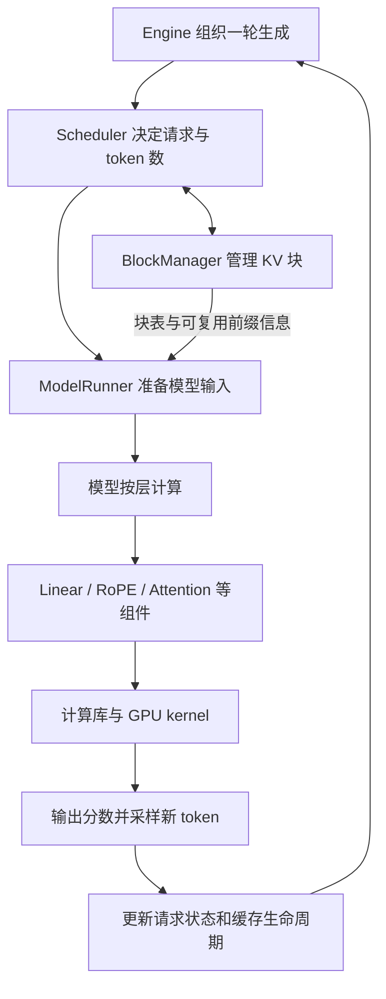

# nano-vLLM、vLLM 与 DriveServe 源码学习对照

整理日期：2026-10-19。目标是先理解一次请求的完整路径，再定位 DriveServe 的项目增量。源码准备由助手完成；阅读、复述和实验是否掌握仍由用户实际完成情况判断。

## 三份代码各看什么

| 对象 | 本地入口 | 作用 |
|---|---|---|
| nano-vLLM | [README](../../third_party/nano-vllm/README.md) | 看精简的请求循环、调度、缓存与模型执行 |
| 固定上游 vLLM 0.8.5 / V0 | [源码目录](../../third_party/vllm-ba41cc90e8ef7f236347b2f1599eec2cbb9e1f0d/) | 看 DriveServe 实际基于的引擎实现；这是原始源码参考副本 |
| DriveServe | [项目模块](../../driveserve/)、[补丁](../../patches/)、[实验脚本](../../scripts/) | 看接入点、项目策略、正确性修复和实验方法 |

**nano-vLLM 与 vLLM 可以共享设计思想和计算库；DriveServe 直接复用的是固定版本 vLLM。** nano-vLLM 是独立的轻量实现，不是 DriveServe 的代码基座。两份框架之间的所有差异不能都算成 DriveServe 的贡献。

nano-vLLM 固定提交：`bb823b3e06983d71485a8e1f23715ebd87d98ef8`（原参考克隆为 detached HEAD；离线恢复的是同版源码，不含 `.git`）。vLLM 固定提交：`ba41cc90e8ef7f236347b2f1599eec2cbb9e1f0d`。来源、文件校验值和核验范围见 [参考版本记录](nano-vllm-reference.json)。

## 先理解这条循环



这是职责关系图，省略了 vLLM 的 executor、worker 和进程通信。读图时抓住三种连接：调度要检查缓存资源；ModelRunner 把调度结果转换成张量和元数据；Attention 根据这些元数据访问正确的 KV。

## 第一轮：按四站阅读

| 顺序 | 先读 nano-vLLM | 再对照 vLLM 0.8.5 / V0 | 能解释什么就算完成本轮 |
|---|---|---|---|
| 1. 生成循环 | [llm_engine.py](../../third_party/nano-vllm/nanovllm/engine/llm_engine.py)：`LLMEngine.step` | [llm_engine.py](../../third_party/vllm-ba41cc90e8ef7f236347b2f1599eec2cbb9e1f0d/vllm/engine/llm_engine.py)：`LLMEngine.step` | 为什么生成多个 token 要反复调度、执行、更新状态？ |
| 2. 调度与缓存 | [scheduler.py](../../third_party/nano-vllm/nanovllm/engine/scheduler.py)：`schedule/postprocess`；[block_manager.py](../../third_party/nano-vllm/nanovllm/engine/block_manager.py) | [scheduler.py](../../third_party/vllm-ba41cc90e8ef7f236347b2f1599eec2cbb9e1f0d/vllm/core/scheduler.py)；[block_manager.py](../../third_party/vllm-ba41cc90e8ef7f236347b2f1599eec2cbb9e1f0d/vllm/core/block_manager.py)：`SelfAttnBlockSpaceManager` | 为什么排在前面的请求也可能不能运行？哪些 KV 块能够释放或复用？ |
| 3. 输入准备 | [model_runner.py](../../third_party/nano-vllm/nanovllm/engine/model_runner.py)：`prepare_prefill/prepare_decode/run`；[context.py](../../third_party/nano-vllm/nanovllm/utils/context.py) | [model_runner.py](../../third_party/vllm-ba41cc90e8ef7f236347b2f1599eec2cbb9e1f0d/vllm/worker/model_runner.py)：`prepare_model_input/execute_model` | 除了 token ID，为什么还需要 positions、长度、slot_mapping 和 block_tables？ |
| 4. 模型与算子 | [qwen3.py](../../third_party/nano-vllm/nanovllm/models/qwen3.py)：Attention 的 `forward`；[attention.py](../../third_party/nano-vllm/nanovllm/layers/attention.py) | [qwen2.py](../../third_party/vllm-ba41cc90e8ef7f236347b2f1599eec2cbb9e1f0d/vllm/model_executor/models/qwen2.py)：`Qwen2Attention.forward`；[flash_attn.py](../../third_party/vllm-ba41cc90e8ef7f236347b2f1599eec2cbb9e1f0d/vllm/attention/backends/flash_attn.py)：`FlashAttentionImpl.forward` | 模型怎样组合计算组件？谁写 KV，谁按块表读取 KV？ |

第一站只需跟住 `schedule → model_runner.call("run", ...) → postprocess`。第一次先跳过 CUDA Graph 捕获、多卡通信和 kernel 内部实现；走通四站后，再回来看这些分支。

两份实现的组织方式不同：nano-vLLM 把采样结果交回 `Scheduler.postprocess`；vLLM V0 的输出处理涉及 `LLMEngine._process_model_outputs` 和输出处理器。应对照职责与数据流，不强求同名函数逐行对应。

## DriveServe 在哪里复用、在哪里修改

| 主题 | 两个框架中可以对照的机制 | DriveServe 的实际增量与阅读入口 |
|---|---|---|
| 请求与执行循环 | 入队、分批、模型执行、结束与释放 | 复用 vLLM 主流程；[engine_trace.py](../../driveserve/engine_trace.py) 和 [observers.patch](../../patches/vllm-v0.8.5-observers.patch) 添加可关闭观察器。完整路线见 [引擎诊断](../../docs/engine-diagnostics.md) |
| 前缀缓存与调度 | block table、引用计数、前缀复用、资源不足时的处理 | [engine_policies.py](../../driveserve/engine_policies.py)：冷热保留与带老化的长度排序；[heap_policy.py](../../driveserve/heap_policy.py)：淘汰候选维护；[policies.patch](../../patches/vllm-v0.8.5-policies.patch)：接入点及 WAITING 前缀计数修复。底层分页与引用计数仍复用 vLLM |
| 模型和 Attention | QKV 投影、RoPE、KV 写入、Attention | Qwen2.5 使用上游 `qwen2.py` 路径，FA2 复用上游能力；并非重写完整 Qwen 或 Attention 实现 |
| 推测解码与蒸馏 | nano 当前快照没有对应的 draft/target 验证链，需要回到 vLLM [spec_decode](../../third_party/vllm-ba41cc90e8ef7f236347b2f1599eec2cbb9e1f0d/vllm/spec_decode/) | [spec_control.py](../../driveserve/spec_control.py)：实际 K 控制和统计；[spec.patch](../../patches/vllm-v0.8.5-spec.patch)：控制器接入及采样修复；[train_draft.py](../../scripts/train_draft.py)：草稿模型训练。核心提议与验证仍建立在 vLLM 上 |
| AWQ 量化 | 从 Linear 层理解权重格式与计算实现；nano 当前快照没有对应的 AWQ 集成 | [quantize_awq.py](../../scripts/quantize_awq.py) 复用 AutoAWQ，项目负责校准数据、配方对照、误差和部署评测；vLLM 负责量化模型执行 |
| RoPE + KV 写入融合 | nano 的 RoPE 与 KV 写入、vLLM 的 rotary 与 cache 写入路径 | [rope_cache.cu](../../csrc/rope_cache.cu)、[rope_cache_tiled.cu](../../csrc/rope_cache_tiled.cu) 是项目自编独立融合原型；[rope-cache.md](../../docs/rope-cache.md) 说明契约与对照。未接入完整服务，不能画成默认推理链上的实际替换 |
| CUDA Graph、张量并行与部署 | nano 的 ModelRunner、[linear.py](../../third_party/nano-vllm/nanovllm/layers/linear.py) 可展示捕获重放、权重切分与通信 | DriveServe 复用 vLLM 的 Graph/TP 能力，通过 [benchmark_deployments.py](../../scripts/benchmark_deployments.py)、[benchmark_openloop.py](../../scripts/benchmark_openloop.py) 比较部署和请求指标 |

项目实验采用不同 profile，表中各项不是同时开启的一套默认配置。当前验收与实验结论以 [最终报告](../../docs/final-report.md)、[兼容矩阵](../../docs/s5-compatibility.md) 为准；早期专题文档中的阶段状态和初测数字要按其日期阅读。

**辨认项目改动时，看“上游原文件 → DriveServe 补丁 → driveserve 中的实现”。** 固定上游目录保持原样，运行时由 [build_vllm_overlay.py](../../scripts/build_vllm_overlay.py) 核验文件 hash，并构造独立 overlay。仅打开 `third_party/vllm-...` 看不到已应用的项目补丁；只对比 nano 与它，也无法直接辨认项目增量。

## 算子怎样支持不同模型

模型定义层的组合顺序和参数；公共组件调用满足输入形状、精度、硬件与缓存布局要求的实现。例如：

```text
模型中的 QKV 投影 → Linear 组件 → 矩阵乘法实现
模型中的 RoPE → 旋转位置编码实现
模型中的 Attention → KV 写入 + 注意力计算实现
```

nano 当前 `Attention.forward` 调用 Triton 的 `store_kvcache_kernel` 写入缓存，再调用 FlashAttention 接口。vLLM 的 FA2 后端调用 `reshape_and_cache_flash` 写缓存，再按阶段和配置选择注意力路径。两者操作目标相通，封装、布局约束和支持范围未必相同。

`slot_mapping` 回答“本轮新 KV 写到哪里”，`block_tables` 回答“这个请求的历史 KV 分布在哪些块”。这是最适合先追踪的两条跨模块数据线。kernel 通常依据数据契约工作，不是依据“模型叫 Qwen 还是 Llama”工作；模型结构与权重加载仍需单独适配。

## 版本差异与本地使用

- 本次 nano 快照已有简化的 chunked prefill；`Scheduler.schedule` 返回一个 `is_prefill` 标记，每轮走 Prefill 或 Decode 路径。不要据此推断 vLLM 的混合调度细节，也不要沿用“nano 完全没有分块 Prefill”的旧教程结论。
- nano 当前 ModelRunner 直接实例化 `Qwen3ForCausalLM`；DriveServe 的目标与草稿是 Qwen2.5 系列，走 vLLM `qwen2.py`。可以对照通用结构，具体归一化、参数和权重加载不能机械照搬。
- 本次只克隆与静态阅读，未安装 nano 依赖、下载新模型或运行它的 benchmark。上游 README 的性能表不是本项目的比较结果。
- 本页及版本记录已保存在 `docs/interview-prep/`；两份固定源码的归档、逐文件 SHA256 与许可证随 Git 提供。`third_party/` 仍被忽略，恢复后可直接点击上述源码链接。
- 如果 IDE 全局搜索找不到参考源码，关闭搜索面板的“使用排除设置和忽略文件”，或直接点击文件链接。

在任意新克隆的项目根目录，使用系统 Python 3.11+ 离线恢复并核对：

```bash
python3 scripts/restore_learning_sources.py
python3 scripts/restore_learning_sources.py --check
```

共核对 vLLM 2,352 个文件、nano-vLLM 26 个文件。归档包含原始许可证，不包含 `.git`、模型或依赖；不要对恢复目录使用 `git rev-parse HEAD` 判断上游版本（它可能返回父仓库 DriveServe 的 SHA）。以[源码清单](assets/reference-sources.json)和上述哈希检查为准。已有同内容文件会跳过，有不同内容的文件会保留并报错。

若另需 nano 的 Git 历史，可在其他空目录按[版本记录](nano-vllm-reference.json)中的仓库与 commit 重新克隆；阅读对照无需联网。

第一轮自检：合上源码，复述“请求入队 → 调度与缓存检查 → 输入准备 → 模型与算子 → 新 token 与状态更新”，然后分别指出一处 vLLM 原生能力、一处 DriveServe 改动，以及这处改动通过什么数据或接口与其他模块连接。
