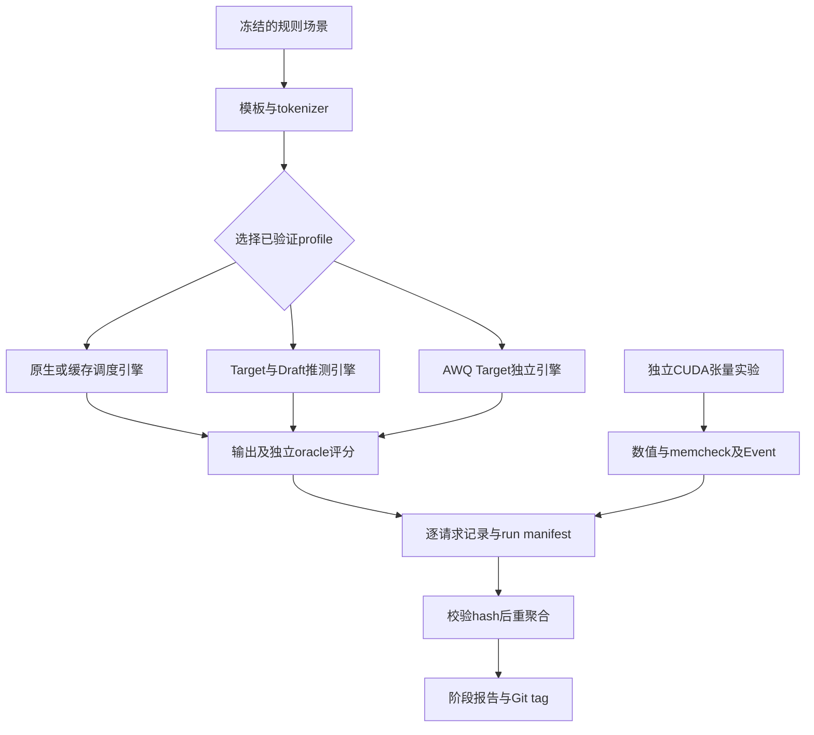

# 从零到 S3 的累计讲解与追问

本项目用结构化车载决策代理任务研究推理基础设施；输入是道路、障碍与车辆状态，输出 action、speed_band、must_yield。规则真值独立于模型输出。这里没有感知、控制或真实车辆安全验证。阶段验收、结果数值和发布版本以同目录的验收报告为准；以下讲解覆盖 S1 到 S3；阶段是否验收仍以本目录acceptance.md及证据审计为准。

## 全景和演进

从空仓库开始，先建立场景生成、评分器、SSE 客户端、环境锁定和运行证据协议。S1 在真实双 RTX 4090 上跑通 Qwen2.5-7B-Instruct、1.5B Draft、单卡和 TP2，并用全新环境重建与 OSS 下载校验验证恢复入口。实际每卡报告 49140MiB，没有 NVLink，P2P 检查失败；不能把这些结果外推成真实 24GB 卡或已发生宿主迁移。

S2 沿六条线形成可回放的实现和实验。先用固定 vLLM 0.8.5 源码、开关观察器和 Nsight 确认真实执行，再接入冷热淘汰和长度 admission。随后实现运行时 K、修复采样边界、完成教师生成和 128 步 LoRA 蒸馏；独立完成三组 AWQ 校准、CUDA 融合原型、FA2 及 HTTP 三部署对照。它们是不同 profile，不能声称全部同时打开。默认保留 FP16 Target 和原生策略，实验优化不自动成为发布默认。

正式数据是 train512/calibration256/dev128/final-test256，场景组与精确内容跨 split 隔离，与旧 fixture 无重复。公共规则与模板仍共享，不证明跨模板泛化。S2 用 dev 作选择，final-test 留到 S5。教师640条只来自 train/dev；472条合格 train 进入训练，40条规则错误保留并排除。独立规则质量与模仿教师的 loss 是两种指标。

所有正式实验要求 clean Git SHA，保存环境、配置、模型/数据 hash、原始输出和进程指纹。任务中断后先检查 PID、boot_id、start_ticks，避免重复启动。训练保存优化器、scheduler、RNG 和数据 cursor；AWQ 只保存逐层进度，意外中断须重新校准整组。GitHub 保存源码和小证据；OSS 保存权重、训练状态和环境并逐包完整读回。没有后台自动开机或会话自动恢复承诺。

## 源码阅读路线：跟随实际输入

1. 从 `driveserve/task.py` 的场景校验、`messages` 和 `score` 开始，理解 oracle；读 `scripts/freeze_task_data.py` 和 data/frozen-v1/manifest.json 核对用途隔离。
2. HTTP 请求经过固定上游的 OpenAIServingChat/OpenAIServingCompletion、MQLLMEngineClient 和 MQLLMEngine，再到 LLMEngine；同步实验直接进入 LLMEngine。读 [完整调用链](../../engine-diagnostics.md)，不要忽略 MQ 进程边界。
3. 依次读 Scheduler.schedule、SelfAttnBlockSpaceManager、PrefixCachingBlockAllocator，再读 `driveserve/engine_trace.py` 和 `engine_policies.py`。用一个 request_id 跟踪 enqueue→schedule→allocate→ModelRunner→output→free。
4. 读 Qwen2Attention.forward、RotaryEmbedding、FlashAttentionImpl.forward，关联 `csrc/rope_cache.cu` 的 packed QKV 和 cache slot；用 Nsight correlation ID 关联 CPU launch 和 GPU kernel。
5. 读 `driveserve/spec_control.py` 与 spec patch，再沿 `generate_teacher.py`→`train_draft.py`→`export_draft.py`→`benchmark_speculation.py` 跟踪 Draft 的实际产物。
6. 沿 `freeze_awq_data.py`→`quantize_awq.py`→`benchmark_speculation.py`→`analyze_awq.py` 检查 W4 产物；最后读 `benchmark_deployments.py` 和 `analyze_deployments.py`，从逐请求 SSE 重新计算结果。

## M1：源码和诊断

研究机会是区分排队、前缀复用、CPU dispatch 和 GPU 计算，不能先假定 KV 访存是瓶颈。原生 vLLM 已有 APC、调度、FA2 和部分指标。项目增量是在锁定文件上加入可关闭观察器及 NVTX，保存真实 enqueue/schedule/KV/model/output 事件；没有重写引擎。

一次请求用 request_id 连接入队、分配和输出。Python 主机方法耗时包含 dispatch/等待，不能作为 CUDA 时间；Nsight 通过同进程 correlation ID 连接 launch 与 kernel。本次 70,804 个 kernel 的时间线显示主要 GEMM 占时长和约 90.94%，只支持“小负载以 GEMM 为主”的观测，不能推出业务 KV 带宽瓶颈。

正确性由观察器开关下的相同输出核对；初诊24条相同，后续压力36条也相同。S2一次开关计时差约1.4%，包含运行波动，不是严格因果开销。源码未插桩的 HTTP/MQ 函数没有逐函数耗时结论。S3已按预定顺序完成三轮独立重复和异常请求检查，不用增加日志量冒充更强证据。

追问：为什么要同时记录 host 和 GPU？前者解释引擎控制成本，后者区分实际计算与间隙。为什么不能把间隙全部当空闲？还可能有内存操作、其他 stream 或等待。为什么没观察到预设瓶颈也有效？诊断的作用是决定下一步，不是验证原稿措辞。证据与复现见 [引擎诊断](../../engine-diagnostics.md)。

S3增量：独立初始化的B1四策略及native trace开关每轮各36条请求。比较的是同一执行源码、相同输入/配置/环境；`scripts/analyze_replication.py`逐请求核对token和状态，并从phase时间重算吞吐。三轮trace开关总时间差分别+0.259%、+0.703%、+0.729%，仍包含运行波动；各轮绝对值见[稳定性主表](../../s3-stability.md)。HTTP真实404/400/400后有效请求成功；本地SSE fixture验证截断、缺usage、坏JSON、服务错误和传输超时，明确fixture不是模型成绩。闭环客户端并不提供独立到达率或排队SLO；恶意慢滴流的严格全程截止尚未单独验证。

## M2：冷热缓存与长度调度

原生 APC 按 hash 复用完整块，并在零引用候选中淘汰。项目 `ColdHotEvictor` 用首次 Prefill 真正跳过的连续完整块计有效复用，两次变热、30秒未复用回冷；先淘汰冷块，再按最近访问、前缀长度和 block_id 排序。元数据以 content_hash 为键，淘汰清理，重新激活保留历史；同批去重、promotion 和 Decode 不重复加命中。

一次 WAITING 请求进入 `_schedule_prefills` 时，等待超过0.25秒的按入队时间优先，否则按已知 prompt 长度。原始 token/KV/maxseq admission 检查仍生效，不读取未来输出长度，老化不能越过资源不足。这是同一 GPU KV 池的保留优先级，不是 CPU/GPU 交换。

首次压力实验发现 WAITING 前缀缓存计数在块淘汰后陈旧。用真实原生分配器复现4→4的错误，补丁让 WAITING 重新查 resident hash，RUNNING 连续 Prefill 才沿用计数，修复后4→0。四策略均用同一正确性补丁；不能把修复算性能创新。原始失败日志仍保留。

四组对照是 native/cache/scheduler/both，B1 经有限 eager/Graph、maxseq2/4/8 比较选 Graph/4。288条开关输出一致，两个生命周期实验各792次不变量检查覆盖共享、running/waiting取消、块重用与 RECOMPUTE。冷热策略在热点冲刷后保留992tokens复用；短请求更早但长请求 TTFT 增加，整体吞吐未证明稳定收益。扫描候选是 O(空闲块数)，S3已将维护成本与GPU时间分开记录。

追问：为什么活动块不能淘汰？上游 refcount 和共享 block table 仍引用它。为什么命中增加不保证吞吐增加？省去的是 Prefill，而 Decode、扫描和排队可能主导。为什么有老化仍不承诺无饥饿？仅控制 admission 顺序，资源和请求执行可继续阻塞。范围限 V0 非 chunked single-step FCFS n=1，swap/beam/TP 未验。源码、数字和复现见 [缓存调度](../../cache-scheduler.md)。

S3增量：三轮cache/both在热点probe均复用992tokens，原生为0；native/scheduler/both短组平均等待533.329/17.390/18.039ms，长组188.176/473.977/474.022ms。cache最终场景扫描累计12.73–12.82ms，both为15.32–16.27ms，这不是总服务瓶颈证明。正式计时不加侵入性快照；生命周期与维护trace单独核对。后续深化候选是减少大空闲池扫描成本，须独立实测规模曲线再作选择，不能把理论O(N)直接写成已经改善吞吐。

## M3：运行时 K 与实际蒸馏

原生固定 K 的 scheduler 预留候选空间，Draft 提议、Target 验证，拒绝后回滚，处理 bonus/EOS/长度。项目保留最大 K=4 的资源预留，worker 在提议前复制执行请求的外壳并改实际 K。控制器初始2，8批滑窗与8批持有期，接受率低于0.45减K、高于0.8增K，界限1–4。实际 proposal 和 verification 宽度记录在轨迹；不是重启服务换参数。

接受率分子只计连续接受前缀，分母为实际提议数，不含 bonus，计数位于 EOS/长度截断之前。原生固定分母指标不能直接用于动态 K；项目另记实际分母。MQA 带 seed 的原生实现按 seq_ids 而非 sample_indices 初始化随机行，20行只填4行；补丁修正跨度与过滤后 seed 映射，CUDA 分布实验和真实模型回归分别验证。不能将修复说成采样算法创新。

Draft 与 Target 同 tokenizer 但 logits 词表分别151936/152064，零填128行只解决维度且改变 softmax，不等于训练。真实训练另用472条合格教师输出，rank8 LoRA、128 optimizer步、microbatch2×accum4、仅答案含EOS loss。第8步 checkpoint 可见后发 SIGTERM，第9步保存退出，恢复至16步与连续参考的 adapter/优化器/scheduler/RNG/loss/样本顺序 bitwise 相同；最终完整 checkpoint 和合并模型保留。

贡献分离在同137请求比较原 Draft fixed、新 Draft fixed、新 Draft adaptive 和 Target。两种 fixed 均137/137序列相同，adaptive136/137，质量均121/128。接受率83.90%→86.92%，动态88.61%；单次带trace吞吐没有超过Target。近似/并列FP16 logits能解释已诊断位置的分歧，不承诺全序列严格相同或通用分布等同。默认关闭推测，保留可回放 profile。

追问：为什么接受率高还可能慢？Draft成本、验证宽度、CPU同步、batch与bonus共同决定总成本。为什么只比较新adaptive和原fixed不能证明蒸馏贡献？训练和控制器同时变化，须固定K比较训练，再固定Draft比较控制。为什么模型权重恢复不等于续训？优化器动量、LR、RNG和cursor也决定后续更新。详见 [推测](../../speculation.md) 与 [蒸馏](../../distillation-protocol.md)。

S3增量：显式开启CUDA Graph后，Target、原fixed、新fixed、新adaptive各137完成且业务121/128；三种推测与Graph Target均137/137 token相同。动态轨迹实际K为2/3/4，发生5次切换，覆盖拒绝/bonus/EOS/长度/上下文和不提议。S2 eager的136/137差异仍保留，不能通过换模式抹去旧限制。诊断时GPU1校准的时间排除出正式表；正式重复期间两卡无其他实验，带trace和无trace分开。训练未重复，继续引用128步产物和SIGTERM完整恢复；dev质量与训练用teacher答案loss分开。种子采样修复与120000次已知分布检查不是“任意模型严格等价”的数学证明。

## M4：三组 AWQ 与显存口径

目标是测压缩的质量、容量与速度取舍。AutoAWQ 提供 scale 搜索、clip、GEMM打包；项目冻结 WikiText2 train 与领域 calibration，各32×512=16384tokens，导出 general128/domain128/domain64。原 Target、Draft 与上游现成 AWQ 冒烟模型分别保留，不能混淆个人校准产物。

选择0/13/27层覆盖前中后深度，每层7个线性层，固定抽256个校准输入；对 scale 后、clip 前的权重和 clip+W4 的伪反量化权重做FP32 XW比较。relative MSE=平方误差和/参考平方和，是局部失真；两类来源的输入分布不同，不能当同输入因果效果。完整dev规则质量才提供共同任务评价。

推理显式使用原生 awq，记录实际后端、tensor dtype/shape/字节。embedding、lm_head、norm、bias等仍高精度。固定512 KV块比较运行显存；另在相同0.5总预算下让引擎实际分配KV。逻辑权重字节、Torch allocated/reserved、nvidia-smi进程占用和KV容量必须分开。容量是已分配token槽位，不是实测可服务同等数量请求。

事前规则默认domain128；general质量更高才换来源；group64恢复FP16质量，或代表层平均MSE降至少25%且吞吐退化不超过5%并保持候选质量时，才优先64。当前结果及选择见 [AWQ结果](../../awq-results.md)。137请求含128业务和9边界，输出长度会变化，token/s不能单独证明等工作量加速。首次shape元数据误调用失败保留，修复后从新run重测。

追问：为什么不是全模型4bit？大词表embedding/lm_head等仍FP16且scale/zero也占空间。为什么显存总占用可能不降？省出的权重空间被引擎分配给更多KV。为什么MSE好不必然业务好？局部校准失真不等于端到端离散决策质量。S3重点是质量阈值、独立重复和后端一致性；不修改目标或使用final-test调参。协议与完整复现见 [AWQ协议](../../awq-protocol.md)。

S3增量：相同domain128 recipe独立重新校准28层，13导出文件与原产物逐字节相同，21项局部误差也完全相同；新provenance保留，云端复用已经完整读回的同内容对象。不是仅比配置文件，也不是只复用旧模型跑推理。质量门槛事前定为完整dev128均完成/JSON有效，正确数至少FP16少1条，本次最低120。通用128的118不通过，领域64/128及Marlin128的121通过。该阈值不是统计非劣效或驾驶安全。原生AWQ与Marlin在long-1合成请求有输出差异，业务集合相同；后端一致性结论必须限定。三轮Marlin总时间9.7222±0.0118s，原生领域128为12.0830±0.0006s；是同137请求观察，输出与FP16的长度不同，不能外推任意等工作量收益。更快的Marlin属于上游能力。

## M5：独立 RoPE+KV append 融合

目标是减少相邻小算子的launch和中间读写，不预设服务一定受其限制。上游目标路径先 rotary_embedding，后 reshape_and_cache_flash。项目自己写一个每token一个block、256线程的 CUDA kernel，读packed QKV，旋转Q/K，直接写K/V到slot；Q/K原地更新，V和未写slot保持原值，负slot跳过写cache。

支持FP16、NeoX完整D128、Q28/KV4、cache `[2,blocks,16|32,4,128]`，token行可有尾部填充。slot唯一、连续int64索引、可写张量与其他输入不共享存储等是显式前置条件。48数值用例检查Q/K/V/未写区域，16组memcheck无错误，4类非法索引被拒绝。首次因Ninja路径编译失败保留；重建记录nvcc12.1、torch cu124、sm89。

CUDA Event在Graph中测100次等价操作，20样本，随机配对顺序，编译/分配/重置在外；两路径均重复原地旋转，属于缓存热微基准。6形状初测融合更快，但没有服务接入或TPOT结论。固定FlashInfer v0.2.1.post2的RoPE/page是分离接口，不把不同工作量的fused attention放进对照，也不声称所有新版本都无融合。

追问：为什么同时检查未写slot？越界或错误slot可在目标输出正确时破坏别的请求。为什么不能直接拿Python计时？异步GPU会让dispatch与执行混淆。为什么微基准改善不能加到模型吞吐上？占比、依赖和其他瓶颈会改变总收益。源码、原始240样本与命令见 [CUDA原型](../../rope-cache.md)。

S3增量：扩展探针发现4类positions/slots与projection/cache共享存储未被原入口阻止；探针在extension dispatch前拦截，没有执行危险kernel或观察到实际OOB。修复后4类均在dispatch前拒绝。最终24类非法dtype/layout/index/alias输入全部拒绝且存储未变，只读indices互相共享的正例通过；全负slot不写cache。修复未更改CUDA源，48组完整数值及独立16组memcheck回归通过。正式重复仍用同一融合核心，48正确性×独立进程以及6shape Event保留各次样本。边界容差与上游逐元素一致要求均未放宽；独立memcheck不能并入计时。固定上游/FlashInfer核查范围沿用相同SHA，不能声称较新版本没有融合。第一轮融合时间从T1约2.73μs到T2048约13.76μs，后续拟研究小T的一token一CTA并行度，尚无新版kernel收益。

## M6：FA2、时间线和部署

FA2复用上游能力，用显式FP32矩阵乘/softmax参考验证，八形状最大绝对误差0.0012522，在atol=rtol=0.003范围。比较对象是PyTorch原生flash SDPA，不关闭成熟flash制造优势；双方kernel trace都证明实际flash路径。两者初测接近，不能写自研Attention加速。

HTTP部署使用同64 dev请求、prompt512/1536、global concurrency1/8，各单元4热身+64测量，FP16/V0/FA2/Graph、APC与chunked关闭。单卡maxseq8；双副本每卡4、按序号轮询；TP2全局8。双副本与TP2均两卡，每卡显存比例0.45；单卡作为一张卡的资源效率参考。输出长度、质量、失败和逐请求SSE都保留，采集与Nsight正式计时分开。

最初的三部署只是不匹配冒烟，后来才补齐本矩阵，不能混用早期并发2/4的数据。TP2无NVLink并不能单凭拓扑判定慢，需分长度/并发看实测。P99在64样本下只是探索性的最大次序统计，S3独立重复仍不把64样本P99当最终稳定收益；SSE chunk不是逐token时间。结果、建议和复现见 [部署结果](../../deployments.md)。

追问：为什么相同GPU数仍需报告预算？maxseq、KV、Graph与cache状态都会改变结果。为什么轮询在并发1未必能用满两卡？闭环请求没有同时在途，第二张卡不会凭空增加并行度。为什么不能把FA2算子数值当模型完整数值证明？模型还有投影、norm、采样及并行归约。FA2/Nsight分别见 [FA2](../../fa2-prefill.md) 与 [诊断](../../engine-diagnostics.md)。

S3增量：三种部署每轮总768请求，TP2长填充dev-030与单卡/副本存在相同差异。这个dev-030实际scene是车速1.43m/s、前车87.003m、红灯、无行人/封道、能见度clear；独立规则因红灯要求stop/stopped/true。诊断沿共同前三token取第4token：单卡stop比pro的logprob高0.03125，TP2二者并列；共同前缀单步Prefill另测单卡差0.015625、TP2仍并列。它与并行FP16数值路径相符，不隔离NCCL为唯一原因，也不能把规则错误视为正确。每轮FA2八shape都保留真实kernel路径及数值参考；性能来源是独立Event，不用Nsight运行充当普通吞吐。第一轮没有温度/功耗快照，第二轮起补任务前后状态；不补造旧记录，不承诺热状态完全受控。

## 分层讲解与学习状态

两分钟介绍：我以规则车载代理任务搭建固定版本vLLM实验平台，亲自实现冷热前缀淘汰、长度老化admission、运行时K控制和RoPE+KV融合CUDA，并实际训练1.5B Draft及导出三组7B AWQ。用共享/取消/抢占检查、训练中断续训、原始请求重聚合和OSS读回验证工程。Graph固定K在本次负载中缩短总时间但TTFT增加，动态K没有稳定增量收益；组合及最终test尚未验证，所以默认仍保留原生FP16；量化节省权重空间与部署适用性分开报告，明确合成任务和小样本限制。

十分钟路线：先讲任务与四类数据用途，再讲运行证据与环境恢复；沿一次请求解释M1/M2，再用K宽度与teacher→LoRA→推理解释M3；用三组AWQ说明质量/局部误差/显存口径；用slot布局和Event对照解释M5；最后按长度与并发解释M6，给出默认配置及未验证范围。深入追问使用每条主线的三个问题和原始报告，不能只背百分比。

材料已生成并可供讲解；用户尚未实际复述或接受追问验证。学习清单：读懂refcount/hash生命周期；手算连续接受率和bonus边界；说明KV容量公式；解释CUDA异步计时；区分teacher loss与oracle质量；从一条原始SSE重算TTFT/TPOT。工程阶段验收不等于用户已掌握。

## S3实验可信度、故障定位与剩余范围

独立单位是每次重启的引擎或算子进程，不是同一次运行里的token、request或20个Event样本。主表保留各run原值、均值、标准差与范围；source fingerprint相同才能合并，文档/聚合改动不会被偷换成新的引擎性能。第一轮聚合发现路径须绝对化且policy analyzer返回tuple，修复后全部原始记录可回放，不能拿聚合器语法通过当指标验证。计划runner一次真实失败返回7，整单元重试成功，再执行只校验已完成记录；这证明恢复协议，不是自动重启平台。

限制保持明确：没有真实车载数据/安全闭环、物理24GB卡或宿主迁移；支持V0非chunked单卡FP16的自研策略/推测profile，TP/beam/swap组合未验。S3没有访问最终测试进行选参。28项CPU检查不是GPU运行替代品；三次重复和64请求尾部不提供生产SLO。最终默认的决定应保留FP16 Target及原生策略，已训练Draft、AWQ、自研策略和独立CUDA各有回放入口，S5才验证适用组合。

学习追问：给出dev-030的共同前缀，解释为什么全序列对比不足以定位数值分歧；从state.json找到真实子run并重算一个请求的TTFT/TPOT；手算短组变快而长组变慢为何不等于系统总体变快；说明AWQ按相同KV与相同总预算会得到不同显存结论。材料可供学习，用户尚未实际复述或被追问验证。

## 一次任务与证据的关系图

图中的三条引擎分支是分别验证的配置，不代表同一进程已经组合；CUDA分支没有连接服务输出。S5才通过实际组合运行决定哪些profile可同时开启。

## S3 最终证据与负结果

三轮正式计时共54个独立进程，39组指标；完整逐run原值、样本标准差与范围见[主表](../../s3-stability.md)及[JSON](../../../reports/s3-stability.json)。Graph Target总时间17.1860±0.0277s，新Draft fixed为14.9691±0.1429s，adaptive为15.1730±0.2435s。每配置137请求，三种推测每轮137/137与Target token相同且业务均121/128；新fixed业务TTFT为110.819ms，对Target88.931ms，因此不能只讲吞吐。动态K无稳定超越fixed的证据，S2 eager旧分歧保留。

固定K的接受率来自独立诊断，不与无trace计时混合：

| Draft | 三次连续接受/实际提议 | 三次接受率 |
|---|---|---|
| original | 2328/2776；2328/2776；2328/2776 | 83.8617%；83.8617%；83.8617% |
| trained | 2325/2676；2325/2676；2325/2676 | 86.8834%；86.8834%；86.8834% |

[16项边界报告](../../../reports/s3-boundaries.json)记录真实allocator4检查、Graph生命周期、维护trace、24非法CUDA输入/48正常数值/16 memcheck及随机Graph等。数据隔离审计读896条train/calibration/dev、224组，640教师中472合格train，四段训练采样日志全部来自eligible train；最终test内容没有被本审计打开，test仍未送模型。只证明记录级/组级隔离，不证明未见模板泛化。

部署三轮2304/2304完成、失败/超时均0。TP2首轮快于后两轮：512×并发8为14.6075/9.8260/9.7960req/s，1536×并发8为6.2838/3.8833/3.9117req/s。执行源、配置、负载和环境指纹相同；日志均NCCL2.21.5、Torch线程64→1、GPU/CPU块32312/9362、Graph开启、自定义allreduce关闭。首轮无温度快照，后两轮只有前后快照，不能确定性能变化原因，不能把三轮均值当紧密稳定的TP2性能或删掉首轮。最终部署需S5匹配复测。长填充dev-030质量差异在每轮都出现，不能因浮点并列改写为通过。

默认FP16 Target/原生策略，保留原/新Draft fixed与adaptive、冷热/长度策略、三组AWQ及Marlin、独立CUDA和FA2入口。S3通过以边界和可回放证据为依据，并不保证所有profile正收益或所有组合可用。累计验收、远端读回、覆盖与六条简历分别见本目录[acceptance](acceptance.md)、[coverage](coverage.md)、[resume](resume.md)、[replay](replay.md)。
